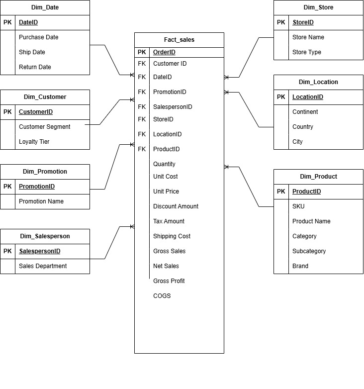

# Retail Sales Data Warehouse | SQL Server

**Data Engineering Project | SQL Server | ETL | Dimensional Modelling | Star Schema**

## Project Overview

This project focuses on designing and implementing a retail sales data warehouse using **Microsoft SQL Server**. The objective is to transform raw transactional data into a structured star schema that supports efficient reporting and business intelligence.

The project demonstrates practical data engineering skills, including database design, dimensional modelling, SQL-based ETL, and data verification.

## Business Problem

Retail businesses generate transactional data across multiple stores, products, customers, and locations. Analysing this information directly from raw datasets can be inefficient.

This project addresses the challenge by organising retail sales data into a central fact table and supporting dimension tables, enabling analysis of sales performance, profitability, customer behaviour, and product trends.

## Tools and Technologies

| Technology | Purpose |
|---|---|
| SQL Server | Data warehouse development |
| T-SQL | Data transformation and loading |
| SSMS | Database management and SQL execution |
| CSV | Source dataset |
| Star Schema | Dimensional data modelling |
| ETL | Data extraction, transformation, and loading |

## Data Warehouse Design

The project implements a **star schema** consisting of one central sales fact table and seven dimension tables.

### Star Schema Diagram



### Dimension Tables

| Dimension | Description |
|---|---|
| Dim_Date | Purchase, shipping, and return dates |
| Dim_Customer | Customer segments and loyalty tiers |
| Dim_Product | Product details, categories, and brands |
| Dim_Store | Store names and types |
| Dim_Location | Continent, country, and city |
| Dim_Promotion | Promotional information |
| Dim_Salesperson | Salesperson departments |

### Fact Table

The central sales fact table contains foreign keys connecting transactions to the dimensions, alongside financial measures such as:

- Quantity and Unit Price
- Unit Cost and Discount Amount
- Tax and Shipping Costs
- Gross Sales and Net Sales
- Cost of Goods Sold (COGS)
- Gross Profit

These measures support sales and profitability analysis across different business dimensions.

## ETL Process

The project uses SQL scripts to transform and load retail sales data into the data warehouse.

```text
Raw Retail Sales CSV
        |
        v
  Staging Database
        |
        v
 SQL Transformation
        |
        v
  Dimension Tables
        |
        v
    Fact Table
        |
        v
  Data Verification
```

**Step 1: Data Source**

The raw retail sales dataset is stored in CSV format and imported into a SQL Server staging database.

**Step 2: Database and Table Creation**

The SQL script creates the staging and data warehouse databases, dimension tables, and central fact table.

**Step 3: Data Transformation and Loading**

SQL statements extract distinct dimension records and populate the fact table using joins to retrieve the corresponding dimension keys.

**Step 4: Data Verification**

SQL queries are executed to inspect the populated tables and verify that data has been loaded.

## Project Repository Structure

All project files are stored directly in the main GitHub repository.

```text
retail-sales-data-warehouse/
│
├── README.md
├── 0.1.retail_sales_raw_data.csv
├── 0.2.retail_sales_schema.jpg
├── 0.3.create_dim_fact_tables.sql
├── 0.4.load_data_into_dims_fact_tables.sql
└── 0.5.verify_data.sql
```

## Project Files

| File | Description |
|---|---|
| `0.1.retail_sales_raw_data.csv` | Original retail sales dataset |
| `0.2.retail_sales_schema.jpg` | Star schema diagram |
| `0.3.create_dim_fact_tables.sql` | Creates databases, dimensions, and fact table |
| `0.4.load_data_into_dims_fact_tables.sql` | Loads data into the warehouse |
| `0.5.verify_data.sql` | SQL queries for inspecting loaded data |

## How to Run the Project

1. Open SQL Server Management Studio (SSMS).
2. Execute `0.3.create_dim_fact_tables.sql` to create the database structures.
3. Import the CSV dataset into the staging table.
4. Execute `0.4.load_data_into_dims_fact_tables.sql` to populate the dimensions and fact table.
5. Execute `0.5.verify_data.sql` to inspect the loaded records.

## Business Applications

The data warehouse provides a foundation for analysing:

- **Sales Performance:** Revenue and profitability across stores and locations.
- **Customer Behaviour:** Sales by customer segment and loyalty tier.
- **Product Performance:** Best-performing categories, subcategories, and brands.
- **Promotions:** Sales performance across promotional campaigns.
- **Profitability:** Gross profit, net sales, and COGS across business dimensions.

## Skills Demonstrated

- SQL Server Database Development
- Data Engineering and ETL
- Dimensional Modelling
- Star Schema Design
- Fact and Dimension Table Development
- SQL Joins and Data Transformation
- Data Warehouse Implementation
- Data Verification

## Conclusion

This project demonstrates how raw retail sales data can be transformed into a structured data warehouse using SQL Server.

By implementing a star schema with seven dimensions and a central fact table, the project establishes a foundation for efficient reporting, business intelligence, and future sales analytics.

## Author

**Yolisa Velebayi**

Data Engineering | Data Analytics | Business Intelligence

**GitHub:** [github.com/Yolisa95](https://github.com/Yolisa95)

---

*Part of my data engineering portfolio showcasing SQL Server, ETL, and dimensional data modelling skills.*
